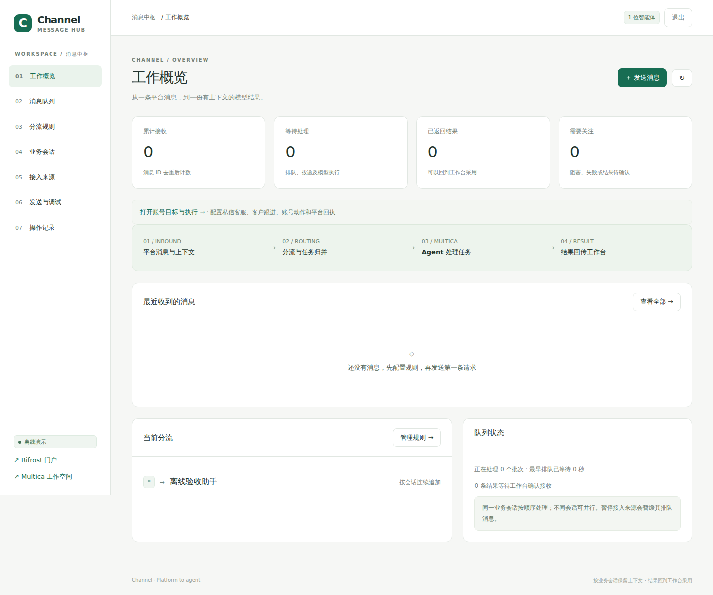

# channel

[](LICENSE)

独立运行的社交工作台消息中枢，将文字、图片和图文请求交给 Multica 的指定 agent，
按会话和业务事项组织任务，并把对应执行的模型结果交还工作台。
Python / Flask 后端、原生 HTML/JS 前端、SQLite WAL 队列，平台登录和真实写入由各工作台管理。

## 界面预览

以下为离线演示截图，使用虚构来源和模拟任务。



## 本机启动

安装 **Python 3.10+**：

```bash
git clone https://github.com/liuyishoua/channel.git
cd channel
python3 -m venv .venv
.venv/bin/python -m pip install -r requirements.txt
.venv/bin/python -m channel_service --demo --data-dir .local/demo
```

打开 **http://127.0.0.1:8780**。演示模式使用模拟 Multica，不创建真实任务或发送社交消息。
访问密码在首次启动时生成并保存在 `.local/demo/admin-password`。按 Ctrl+C 停止。

## 真实模型模式

按 [部署说明](docs/operations.md) 在私有 `.local/multica.json` 中配置自己的 Multica 连接，
然后运行 `.venv/bin/python -m channel_service`。进入工作台配置来源凭据和路由。
工作台凭据留在服务端，模型只接收经过处理的业务上下文。
普通分析结果供查看和采用；账号自动化需单独配置目标、授权和实际平台执行器。

## 数据与备份

- `.local/`：访问密码、来源凭据、连接配置、会话和持久队列，全部忽略 Git。
- 按 `(source, account, message_id)` 去重；远程写入前记录意图，不确定结果先核对。
- 每个消息保留对应结果，同会话串行处理，服务重启后恢复队列。
- 备份前停止服务并复制整个 `.local/`，不要单独复制正在使用的 SQLite 主文件。

## 安装与验证

```bash
.venv/bin/python -m unittest discover -s tests -v
node --check channel_service/static/app.js
```

自动化测试使用临时数据和模拟适配器，不执行真实社交操作。

## 目录

- `channel_service/`：消息路由、持久队列、会话、自动化动作与管理界面。
- `sdk/`：工作台接入 SDK；`tests/`：隔离回归测试。
- `deploy/`：部署示例；`docs/`：设计、API、会话和运维说明。
- [完整功能和集成说明](docs/operations-original.md)。

## 使用许可

**本项目仅供学习、研究、测试及其他非商业用途，不得用于商业目的。**
对本仓库中版权所有者拥有权利的代码，采用
[PolyForm Noncommercial License 1.0.0](LICENSE)；商业使用须事先取得版权所有者的单独授权。
本项目属于**源码可见、限制商用**，不应标为 MIT 或 OSI 意义上的开源许可证。

第三方代码、素材和依赖仍受其各自许可条件约束，来源与许可范围见
[THIRD_PARTY_NOTICES.md](THIRD_PARTY_NOTICES.md)。本声明不追溯改变第三方代码或此前已发布版本的许可。
