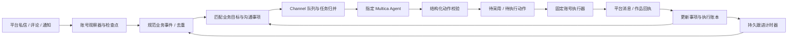

# 从消息中枢到目标驱动的账号工作系统

## 业务定义

用户当前优先目标是「私信客服」和「客户跟进」。两者共用一条技术链路，分别配置 Multica agent、业务知识、沟通目标和跟进策略。客服通常在收到消息后及时决策；跟进增加等待、到期唤醒、再次判断和停止条件。

两类 agent 的可用业务指令见 [agent-profiles.md](agent-profiles.md)，可在 Multica 建为独立 agent 或用于不同目标的策略；本次保留用户现有 agent 配置。

目标不是让模型直接操作任意界面，而是使一个明确归属的执行账号持续完成一件沟通事项：观察事实、理解上下文、决定下一步、执行已允许的动作、取得真实结果，再等待新的事实。人设是沟通风格、业务身份和表达方式；不能用模型捏造身份、价格、库存、配送承诺或成交结果。

## 来源不要只按窗口拆

使用四个相互独立的维度：

| 维度 | 示例 | 作用 |
| --- | --- | --- |
| 平台来源 `source_id` | xianyu、douyin、xhs | 凭据和适配器边界 |
| 执行账号 `account_id` | 平台账号的稳定 ID | 谁观察、谁执行；不能由模型更换 |
| 业务入口 `surface` | dm、comment、notification、content | 私信、评论、通知、作品生命周期 |
| 事件 `event_type` | dm.received、dm.followup_due、content.requested | 为什么唤醒、当前应处理什么 |
| 采集方式 `transport` | poll、socket、webhook、manual、timer | 事实从哪里被发现，与业务入口分开 |
| 内容类型 `kind` | text、image、mixed | 如何交给模型理解 |

例如「通知窗口提示收到私信」的真正业务事件仍是 dm.received，通知是发现方式或关联提醒。若有原始私信 ID，两次发现使用相同的 canonical event ID；若没有，应先解析、回查原始资源，不能凭相似文本猜测后直接发送。普通 notification.received 不具备直接向某个联系人发送的权限。



## 五种核心对象

**目标 Goal** 保存目标、agent、执行账号、业务知识、沟通风格、事件订阅、允许动作、执行模式、工作时间、每日额度、动作间隔、事项动作数和跟进上限。新增默认暂停、先采用后执行；可设置自动模式。已启用的自动目标中，模型明确 requires_human=false 且动作通过规则，才进入待执行队列。

**事件 Event** 是发生过的事实；以 `(source, account, event_id)` 唯一。重复观察返回原记录，内容变化报冲突。自己发出的消息和发布回执只记账，不触发自动回复循环。采集方式变化不会制造第二条业务事件。服务只接受明确类型，定时跟进事件仅允许服务内部生成。

**沟通事项 Case** 绑定一个目标和一个业务目标资源。私信按稳定 conversation_id，评论按明确评论 ID，作品按内容请求 ID。保存最新事件、事项摘要、已确认执行次数和状态。不同平台、账号、客户和目标不混用上下文。相同私信会话内的多订单进一步拆分，需要生产者提供经过确认的业务事项 ID；当前自动化首版按会话管理，不会根据模型猜测自动拆单。

**决策 Job** 将目标版本、输入事件、事项和 Channel 请求绑定。每次决策一个独立模型执行，持续事项追加到同一张 Multica 任务；修改目标产生新规则版本。最新消息到来会撤销尚未执行的旧方案；模型仍在运行时保留远程执行记录，其过期结果不会再变成可发送动作。最近事件和成功发送记录供下一轮参考，超长上下文压缩并标记。

**动作 Action** 是类型明确、内容固定、账号和目标由系统绑定的执行意图，不是任意工具命令。模型不能改变收件人、账号、接口地址或脚本。执行器领取一次性租约，先记本地意图，再调用既有工作台。平台确认、模型完成和业务目标达成是不同状态；当前不依据模型一句“已成交”自动关闭目标。

## 一次完整客服与跟进

1. 店铺账号收到客户「这款能包邮吗？」；观察器保存平台消息 ID 和会话 ID，再提交 dm.received。
2. 服务选择该账号已启用、匹配事件且优先级最高的目标。多个目标竞争时只选一个，避免客服和跟进 agent 同时回复；同优先级按目标 ID 稳定匹配。
3. Channel 将商品事实、目标、历史消息、已发送回执和事项摘要交给目标指定的 agent。
4. agent 返回一句回复草案，并建议 30 分钟后再评估。校验器只接受 dm.reply；客户归属从原事件绑定。
5. 自动策略或人工采用使动作进入 ready。账号执行器检查账号仍一致、工作时间、账号共享额度、动作间隔、事项次数、最新消息和拒绝联系记录，再领取动作。
6. 执行器通过现有闲鱼工作台发送，request_id 固定为 Channel 动作 ID。取得平台消息标识后回传 succeeded；仅「工作台任务创建」不能算成功。
7. **收到发送成功回执后**才创建跟进计时器，不把排队和模型耗时算作等待客户的时间。
8. 客户先回复则取消计时；否则到期生成 dm.followup_due，重新请求 agent 判断。到期不代表一定发送，可以 none 或 handoff。每事项最多跟进配置的次数。
9. 对方要求停止联系时，确定性规则直接停止，撤销未执行动作和计时，不依赖模型是否理解。停止记录跨目标修改保留；当前没有自动清除停止记录的入口。

已经领取并开始的平台写入无法通过「暂停目标」撤销。暂停会阻止尚未领取的动作，已领取动作继续回传实际结果；后续不会安排新的跟进。

## 模型只产出一个受约束的动作方案

```json
{
  "summary": "客户已确认规格，等待确认是否下单",
  "requires_human": false,
  "action": {
    "type": "dm.reply",
    "text": "可以包邮，您需要蓝色还是白色？",
    "images": []
  },
  "followup_after_seconds": 1800
}
```

支持 none、handoff、dm.reply、comment.reply、content.publish。发布使用 title、text、images；图片必须是当前来源与账号已经上传的 asset_id，不能凭空生成 URL。首版一次决策最多一个对外动作，避免出现“先回复成功、再发图片失败、再评论已成功”却无法明确恢复的多步事务。

评论回复和作品发布已具备目标及动作协议、内容与图片归属校验、待执行队列；对应平台执行器尚未完成。图文创作的素材生成、排版、预览和多平台改写应交给内容 agent 与素材服务；发送阶段只处理已经固定的作品版本。不能把「协议支持发布」写成「八个平台都能真实发布」。

## 执行一致性

执行账号内串行；不同账号可并行。账号额度和间隔取该账号全部启用目标的最严格值，避免为同一账号创建多个目标绕过总额度。工作时间使用 Asia/Shanghai。额度按动作领取时刻计数，失败或不确定的写入也占用本次尝试额度。

领取90秒租约。超时后进入 uncertain，阻塞该账号后续动作，不重新投递；原执行器可以凭原租约的凭据补交真实回执。成功必须带平台消息或作品 ID；终态回执重复提交幂等，不能覆盖不同结果。不确定不能解释为失败后重新发送；当前核对需要原执行器保留的私有日志及工作台原任务，管理界面仅展示，不提供绕过账本的重发按钮。

先在执行器本地持久保存事件 outbox，Channel 确认后再删除；再在调用工作台前保存动作意图，结果回传失败只重试回执。启动恢复遇到没有确切响应的写入意图，报告 uncertain，不能重新调用发送。

不确定动作的原领取凭据继续保存在连接器私有日志中。后续通过工作台按固定 request_id 只读查询原任务，取得确切平台消息 ID 后补交原动作回执，不再次调用发送；原任务也不确定时继续阻塞，不能把本地日志删除后重建动作。

## 当前实际平台能力

以下来自本机工作台源码，表示已存在的接口，不代表本次重新验证真实账号可用：

| 平台 | 已有工作台能力 | 本次自动化接入 |
| --- | --- | --- |
| 闲鱼 | 最近会话同步、本地消息、文字/图片发送、商品发布 | 首条连接器：本地消息观察、可选最近会话同步、文字私信执行、账号固定、回执与恢复日志；默认不启动 |
| 抖音 | 账号管理、会话历史、文字/图片发送、任务调度 | 已有 Channel 起草；执行器接入为下一步，需处理原调度与自动化共同占用账号 |
| 小红书 | 内容草稿、创作者发布任务、素材上传；通知主要为系统任务/账号状态 | 已有 Channel 草稿接入；不能把系统通知当成已具备社交私信订阅 |
| B站 | 内容和评论采集，文字动态发布接口 | 暂无自动化执行器 |
| 微博 | 内容和评论采集，文字微博发布接口 | 暂无自动化执行器 |
| 快手 | 内容和评论采集；当前工作台发布被明确禁用 | 暂无自动化执行器；上游文件存在不等于工作台已支持发布 |
| 京东 | 商品和评价研究，本地草稿 | 暂无私信或作品发布执行器 |
| 知乎 | 文章/回答评论研究，本地研究草稿 | 暂无私信或作品发布执行器 |

闲鱼连接器首次扫描只建立历史基线，不把旧咨询当作新请求。默认只看工作台本地已保存消息；sync_recent=true 才调用现有最近会话同步，覆盖范围仍受该接口限制，不是全历史持续 Socket 订阅。图片私信标记 media_unavailable，强制先人工采用；连接器目前只发送文字，不下载任意平台图片 URL。

## 操作与部署

管理页面：<https://portal.example.com:20042/automation>，使用 Channel 同一登录。

1. 配置业务目标，选择对应 Multica agent，填写真实稳定执行账号；先采用后执行用于观察方案。
2. 用 deploy/xianyu-connector.example.json 创建 `.local/xianyu-connector.json`，文件权限0600。样例不包含凭据值，只引用已有私有文件。
3. enabled=true 启动观察；execute=false 只观察和生成方案，绝不领取发送动作；sync_recent 单独控制最近会话读取。
4. 需要发送时把 execute=true，并选择目标执行模式。所有动作仍遵守账号、事项、节奏和停止条件。
5. 手动运行 `.venv/bin/python sdk/xianyu_connector.py --config .local/xianyu-connector.json`，或安装 opt-in systemd unit。默认部署不启用这个 unit，不擅自选择用户已有账号处理全部联系人。

模型 agent 保持分析与方案产出权限。目标编排不会把来源凭据、平台 Cookie 或执行器租约交给模型。平台凭据留在原工作台，Channel 来源 key 在可信后端。执行器本地工作台请求带 X-Execution-Account，由工作台持锁核验当前账号，防止检查后切换账号造成跨账号读写。

## 后续扩展顺序

先在明确账号和目标下跑通客服与跟进的受控闭环，再扩展抖音执行器与既有调度协同；随后补充评论根线程观察与回复、图文素材生成和发布执行器。跨平台客户身份、业务事项自动分支、人工接管后的恢复、分阶段销售指标，以及多节点队列扩容，都应独立设计并以真实事件/回执验证。

不要用“模拟真人”作为随机点击或伪造操作记录的实现指标。可检验的指标应是：目标匹配率、回复相关性、实际平台成功率、重复发送数、人工接管率、拒绝后继续联系数、跟进次数和真实业务转化；最后一项必须来自业务事实。
