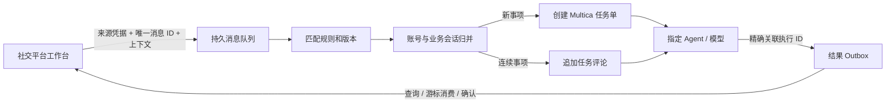

# Channel 消息中枢

将不同社交工作台的文字、图片和图文请求，可靠地交给 Multica 的指定 agent，并把对应执行的模型结果交还工作台。

- 工作台：<https://d.58nft.net:9456/>，已加入 [Bifrost 门户](https://d.58nft.net/)。访问密码保存在 `.local/admin-password`，沿用用户指定的新增服务密码。
- 本机服务：`http://127.0.0.1:8780`，systemd `channel.service` 与 `channel-proxy.service`。
- 业务设计：[docs/design.md](docs/design.md)；接入协议：[docs/api.md](docs/api.md)；部署维护：[docs/operations.md](docs/operations.md)。
- Python SDK：[sdk/channel_client.py](sdk/channel_client.py)，标准库实现，无需把来源凭据交给浏览器。
- 通用会话存储与上下文：[Session 设计和接入协议](docs/sessions.md)，独立于渠道和 agent，支持增量事实同步、查询、记忆依据、固定快照及每轮独立执行。
- 独立业务指挥部：<https://d.58nft.net:9457/>，管理跨平台目标、阶段、账号与 Agent 分工。Channel 接收执行规则并回传证据，原有本地规则仍保留。
- 账号目标与执行：[在线管理台](https://d.58nft.net:9456/automation)；[客服与跟进设计](docs/account-automation.md)；[事件和动作协议](docs/automation-api.md)。



## 已实现

1. 来源独立凭据、停用与轮换；唯一键 `(source_id, account_id, message_id)` 去重，内容冲突返回 409。
2. 来源 × 类别 × 文字/图片/图文的优先级规则；规则编辑生成新版本，已接收消息保留原配置。
3. 独立建单、按会话追加、按业务主题追加；支持明确回复、业务事项分支、主动新建、时间窗口、消息数和上下文容量上限。
4. SQLite WAL 持久队列、事务认领、租约恢复、短消息合批、会话串行、不同会话并行、队列容量保护。
5. 使用 Multica 的实际 API 建单、指派 agent、上传附件、追加评论、关联执行和获取模型最终输出。
6. 远程写入前记录意图；响应丢失先按批次标记核对，不能确认时阻塞该会话，不盲目重建任务。
7. 每个消息保留自己的结果，合批请求共享一次模型执行；结果游标与确认接口支持工作台消费与重启恢复。
8. 管理工作台可配置来源和规则、预览分流、上传图片、查看消息/会话/结果、重新排队未投递请求和核对不确定投递。

## 工作台入口

| 来源 | 集成位置 | 上下文 |
|---|---|---|
| B站、微博、京东、快手、知乎 | 内容卡片「AI 分析」 | 当前账号、内容标识、正文/作者/价格等已有查询结果 |
| 闲鱼 | 会话「AI 起草」、商品「AI 分析」 | 当前账号、最近 20 条本地消息、联系人与关联商品 |
| 抖音 | 对话框「AI 起草」 | 所选账号、最近 20 条本地消息；草稿进入该账号输入框 |
| 小红书 | 草稿页「Channel 智能体」 | 当前工作台用户、草稿主题、标题正文、主动上传的业务图片 |

主动分析入口返回内容可在结果区查看或采用到编辑器，保持原有发送/发布操作。目标自动化通过下述独立配置、动作队列和账号执行器处理，不将普通模型返回值直接当成发送指令。

新增目标编排支持业务事件、固定账号、目标 agent、持续事项、结构化动作方案、自动/人工采用模式、执行器租约与平台回执、工作时间和账号共享额度，以及发送确认后的跟进计时。可选闲鱼连接器复用原工作台执行文字私信；默认未启动，不选择真实账号自动发送。评论回复和图文发布已有动作协议，对应平台执行器仍待接入。范围见 [客服与跟进设计](docs/account-automation.md)。

## 本机运行与验收

```sh
python3 -m venv .venv
.venv/bin/pip install -r requirements.txt
.venv/bin/python -m unittest discover -s tests -v
node --check channel_service/static/app.js
.venv/bin/python -m channel_service --demo --no-auth --port 8870 --data-dir /tmp/channel-preview
```

正式服务不用 `--demo`；`--no-auth` 只允许临时回环演示。真实模型验收脚本 `scripts/smoke.py --execute` 使用纯虚构客服信息和几何图形，不读取真实平台消息、不发送任何外部社交消息。记录见 [docs/acceptance.json](docs/acceptance.json)，包含任务单、消息和执行 ID。

本次测试、浏览器验收与真实模型执行的汇总见 [docs/verification.json](docs/verification.json)，同时记录各项验证范围及未覆盖的边界。

新增账号目标编排的独立验收见 [docs/automation-verification.json](docs/automation-verification.json)：包含目标/动作测试、八个工作台相关回归、演示账号 HTTP 与浏览器闭环、正式 HTTPS 管理页，以及真实 Multica 两轮结构化方案。客服与跟进的 agent 指令见 [docs/agent-profiles.md](docs/agent-profiles.md)。
