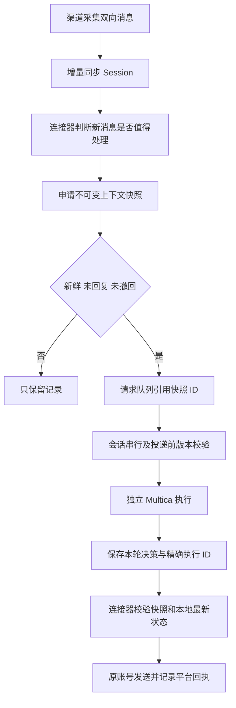

# 通用 Session 存储、查询与模型上下文

## 目标与边界

业务会话长期存在，模型执行有明确起止和有限输入。任何渠道均可使用同一协议；核心不识别 XHS 的私信 ID、Cookie、聊天历史分页或发送协议。平台适配器负责认证平台、采集/修正事实、同步消息及执行发送；Channel 负责共享会话存储、查询、记忆依据、上下文选择、队列串行和执行审计；Multica 负责 agent 与技能执行。

会话身份为 `(source, account, surface, conversation)`。不同来源、账号和入口隔离，群组可用群组 ID 作 conversation。跨平台账号或用户身份不自动合并。agent、模型、路由版本、Multica issue 均不是会话身份，切换它们不丢失历史。机器接口使用已有来源 Bearer 凭据，每次读写还必须显式提供 account_id；不接受浏览器凭据或跨来源查询。

## 数据结构

| 表 | 内容及约束 |
|---|---|
| sessions | 稳定业务身份、消息版本、记忆版本、连接器报告的历史覆盖范围 |
| session_messages | 双向事实；会话内 message_id 唯一，revision 单调递增，按发送时间查询 |
| session_memories | 有来源消息及其版本的 fact/preference/style/open_loop/boundary/observation；CAS 更新及有效期 |
| session_snapshots | 一轮固定输入；请求 ID 幂等、参数冲突409，选中消息、记忆、版本、时效和字节数可复查 |
| session_dispatches | 快照和执行事件绑定；避免换请求 ID 重复触发同一轮 |
| session_decisions | 对应事件、快照和会话版本的简短模型观察，供下一轮参考 |

事实不是模型推理的产物；模型观察不自动升级成已确认记忆。观察只沿用最近一天的一次结果，每个字段限制500字，不把多轮分析串起来；原输入依据被更正或撤回后不再复用这份观察。显式记忆需要消息依据，依据被撤回或更正后不再参与新快照；记忆到期后不再使用。现阶段没有自动从模型分析提炼永久人物画像，也没有向量检索服务。

消息同步与模型触发完全分开。首次历史导入、分页、重连、重复推送只写事实，不入模型队列。同一消息同一版本不同内容返回409；旧版本重试不能覆盖新版本，较高版本允许正文/媒体更正或撤回。群组消息可提供 actor_id 区分成员；发送方向、成员身份与事件时间是身份的一部分，不能通过更正改变。所有消息时间必须带时区，内部按 UTC 比较。

## 一轮处理流程



默认快照包含最近20条连续对话、最多6条相关原文、最多8条有效记忆和最近一次模型观察。相关原文采用确定性的词语/中文二字片段匹配，限最近48小时，优先保留连续最近对话；这不是语义检索。窗口、条数和预算在快照请求里明确配置，服务端设硬上限。默认上下文14,000 UTF-8字节，上限20,000字节；预算是上下文数据预算，不代表包括 agent 技能与运行时提示的整个模型 token 数。

当前新消息只在 messages 中出现一次；current_message、trigger_message_ids 使用引用。裁剪先移除可选记忆/旧观察和额外召回，再移除较旧的尾部对话；不能静默裁剪本轮触发消息，触发消息本身超限则明确拒绝。图片只存素材引用，实际附件通过已有账号隔离的媒体接口传递；每次请求最多8张，catalog.limits 可查询协议上限。

默认触发消息最多延迟15分钟；已经出现更新消息、本人已回复或消息撤回时快照不允许触发模型。快照有效期最多5分钟，过期可申请新快照重新分析。历史窗口不是补回复时效。快照生成时冻结，不因稍后消息或记忆更新而改变；同一个 request_id 重试返回原快照，不能借重试刷新过期输入。

同一会话一次只执行一轮，即使更换路由、版本、agent 也不并行；不同会话可并行。Session 请求每轮创建独立 Channel thread / Multica issue，避免恢复旧 issue 的长上下文。审计记录继续保留，同一 Session 可以追溯多个事件/任务。这是现有 Multica issue API 下的执行适配方式；未来若提供直接 agent invocation，可替换适配器并保留 Session 协议。旧的非 Session 请求仍保留原有按任务追加行为。

远程任务创建之前持久记录写意图；丢失响应按批次标记核对，不盲目重建。已投递的执行先核对其精确 task_id，再推进下一轮。新消息可能在模型执行期间到达：输出不直接等于发送许可，连接器必须在发送前重新检查本地最新消息、会话版本、账号控制方式和回执状态。validate 是一次检查，不是远端平台原子发送事务；不能声称跨两个系统严格 exactly-once，发送回执不明仍须进入 uncertain 并阻止重发。

## 机器 API 与 SDK

所有接口都需要来源凭据。GET 的 account_id 放查询参数，POST 放 JSON。SDK 位于 sdk/channel_client.py。

| 操作 | API |
|---|---|
| 创建/取得稳定会话 | POST /v1/sessions：account_id、conversation_id、surface |
| 列出账号会话 | GET /v1/sessions?account_id=…&limit=… |
| 会话元数据 | GET /v1/sessions/{id}?account_id=… |
| 增量同步，不触发模型 | POST /v1/sessions/{id}/messages：account_id、messages、可选coverage |
| 时间/关键字查询与分页 | GET /v1/sessions/{id}/messages?account_id=…&since=…&until=…&query=…&limit=…&before=… |
| 读取有效记忆 | GET /v1/sessions/{id}/memories?account_id=… |
| 有依据的 CAS 记忆更新 | POST /v1/sessions/{id}/memories：account_id、key、kind、text、evidence、expected_version、ttl_seconds |
| 显式退役记忆 | POST /v1/sessions/{id}/memories/{key}/retire：account_id、expected_version |
| 固定本轮上下文 | POST /v1/sessions/{id}/snapshots：account_id、request_id、trigger_message_ids及可选预算参数 |
| 查看原始快照 | GET /v1/session-snapshots/{id}?account_id=… |
| 检查快照是否仍有效 | GET /v1/session-snapshots/{id}/validate?account_id=… |
| 请求模型执行 | POST /v1/messages：原请求字段＋session_snapshot_id；context仅提供控制方式/媒体目录等应用参数 |

消息格式：`{message_id, revision:1, direction:"inbound|outbound", sent_at:"2026-10-10T14:00:00+08:00", text, media:[], revoked:false}`。批量同步最多200条/1MB，连接器在每个批次成功后记录同步版本；网络重试保持消息ID和revision。查询返回按事件时间倒序，next_cursor 是会话内最后返回记录的游标；不能把其它会话游标拿来翻页。

请求模型时不再提交完整 messages/history/memories 等快照内容，Channel 校验快照的来源、账号、入口、业务会话和版本后装配。应用不能覆盖快照字段，不能通过 new_task/reply_to/thread_id 将本轮接到旧模型会话。相同执行请求重试复用原 message_id；主动重新分析用新的 request_id/message_id 和 reanalysis=true，保留原执行审计。重新分析不是绕过时效或已回复检查的权限。

```python
session = client.session(account_id, conversation_id, surface='dm')
client.sync_session(account_id, session['id'], delta_messages, coverage=coverage)
snapshot = client.session_snapshot(account_id, session['id'], stable_turn_request_id,
                                   trigger_message_ids)
if snapshot['eligible']:
    event = client.send(account_id, stable_model_request_id,
        text='请处理本轮消息', category='reply_draft', conversation_id=conversation_id,
        surface='dm', event_type='dm.received', route_id=route_id,
        session_snapshot_id=snapshot['id'], context={'control_mode':'auto_approve'})
# 查询精确 event 的模型结果，检查最新本地消息和快照，再按平台协议发送。
```

## XHS 首个适配器及迁移

XHS 本地 SQL 继续作为平台收发事实和回执存储。DmConversation.session_state 保存远端会话ID、同步版本和未确认同步意图，按本地历史行ID建立稳定引用，以兼容 WebSocket、ACK 和平台历史接口的消息ID别名。首次把最近48小时历史导入 Session，以后只同步新增和变更，连接器同步账本保留滚动3天。Channel 的集中记录用于跨调用查询和输入构造；两份记录靠来源版本衔接，模型不能反写平台原始事实。

新鲜私信触发时创建快照，保存引用及本轮有限上下文；对模型执行接口只提交快照ID与应用参数。发送开关、三档控制、图片/表情、连续短消息和成功回执校验沿用现有收发适配器。15分钟前的迟到消息仅入历史，不产生回复任务。旧代码缺少平台时间的实时消息仍按接收时间兼容处理；连接器应尽量提供平台事件时间。

已完成的旧任务单不删除，也不导入成新待回复任务。上线后新请求使用独立执行；旧的在途请求按原执行ID核对完成，不改写其已提交的请求。迁移仅新增表和一个同步状态列。备份 Channel 与 XHS 数据库，先部署 Channel，再迁移/重启 XHS；回滚代码时保留新增表/列和审计记录。

## 验收

- 多来源、账号、入口隔离，所有接口拒绝越权与浏览器来源；并发重复同步只入库一次。
- 乱序分页、旧版本重放、更正/撤回、记忆依据失效、CAS冲突、过期输入。
- 同一快照/执行请求响应丢失重试保持原输入，只创建一个远程任务。
- 同一会话路由版本改变仍串行；每轮任务独立，无旧任务历史追加。
- 大历史下每轮原文唯一且预算有界，相关原文召回，触发原文不被静默裁剪。
- XHS 两轮首轮同步历史、次轮只同步增量；发送前新事实会使旧草稿失效。

Channel 单测：`.venv/bin/python -m unittest discover -s tests -v`。
XHS 回归：`.venv/bin/python -m pytest tests/backend/test_direct_messages.py tests/backend/test_channel_bridge.py -q`。
跨项目适配器测试同时使用两个项目已安装的依赖：在 XHS 根目录运行 `PYTHONPATH=../channel/.venv/lib/python3.12/site-packages .venv/bin/python -m pytest tests/backend/test_dm_sessions.py -q`。该测试使用真实 Channel Flask API、SQLite 和 SDK，Multica 为合成适配器，无社交平台发送。
